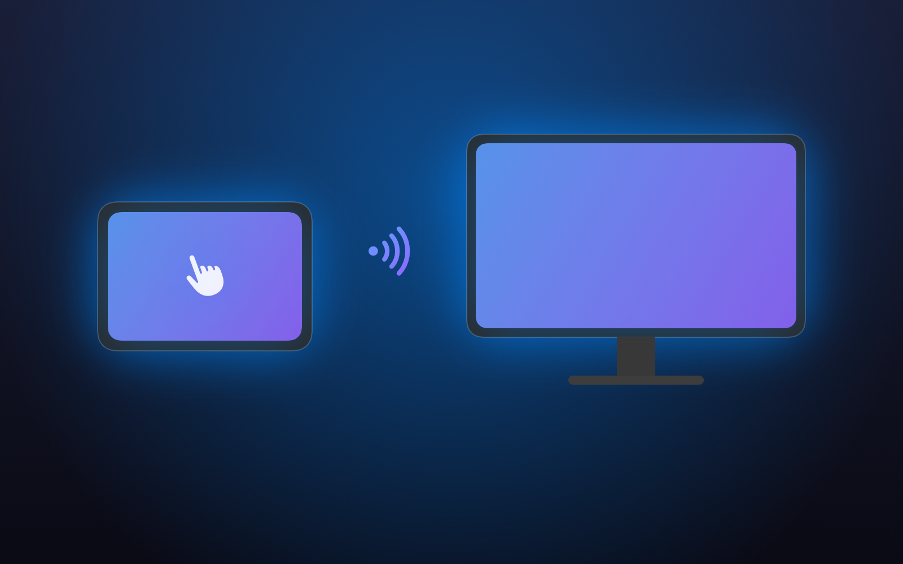
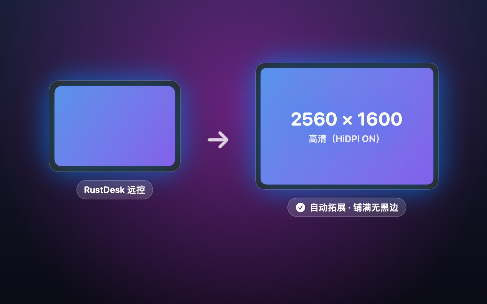
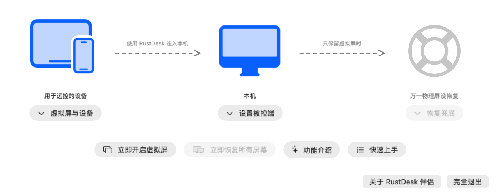
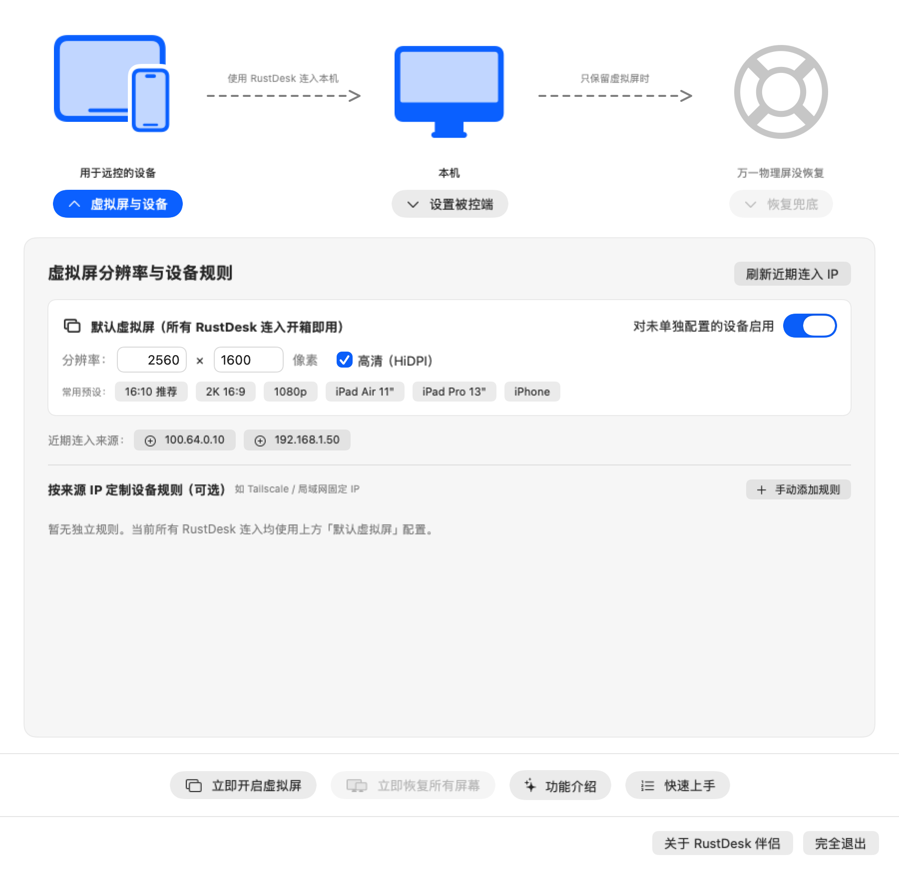
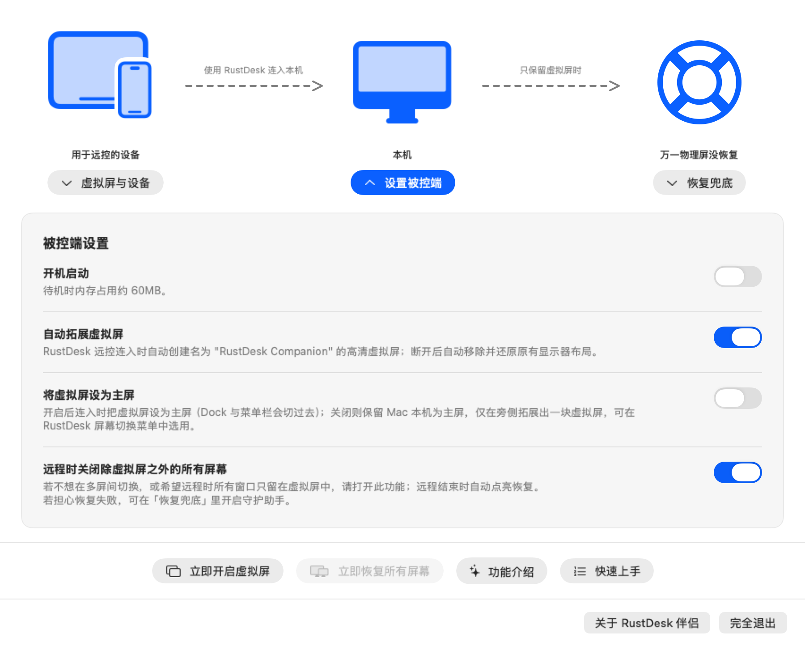
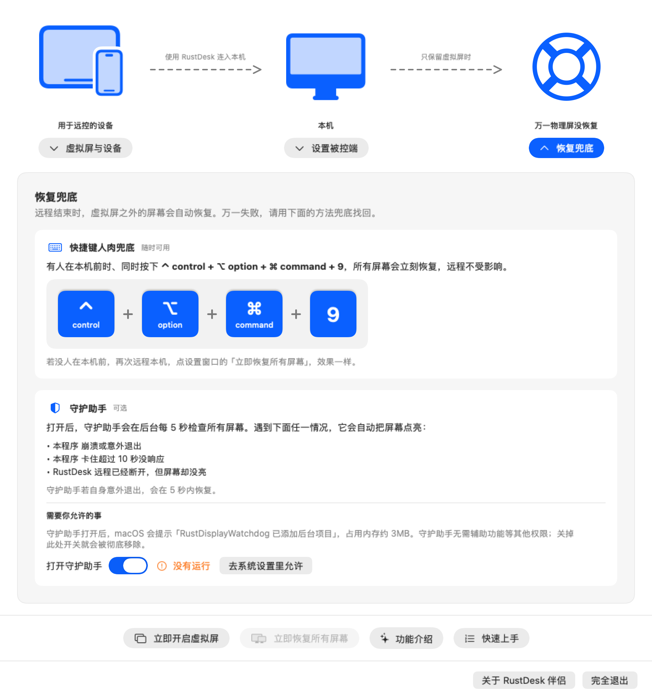

<div align="center">



# RustDesk 伴侣（RustDesk Companion）

**为 Mac 版 [RustDesk](https://rustdesk.com/) 提供远控自动虚拟屏扩展：平板或手机连入时自动拓展适配分辨率的高清虚拟屏，断开后自动移除并还原原有显示器布局。**

[](https://github.com/mzxcpp/RustDesk-companion/releases/latest)


[](LICENSE)

[下载安装](#下载与安装) · [屏幕模式](#屏幕模式) · [使用说明](#使用说明) · [应急恢复](#万一屏幕没有亮回来) · [从源码构建](#从源码构建)

</div>

---

> [!IMPORTANT]
> **项目来源与贡献声明（Attribution）**
>
> - **原版本来源**：本项目派生自 [@aoyamashou](https://github.com/aoyamashou) 开源的 **[aoyamashou/UUyc-companion（UU远程伴侣）](https://github.com/aoyamashou/UUyc-companion)**（[MIT 协议](https://github.com/aoyamashou/UUyc-companion/blob/master/LICENSE)）。
> - **原项目核心基础**：`CGVirtualDisplay` 高清虚拟屏创建、WindowServer 防崩溃逐步收敛状态机、`CGSConfigureDisplayEnabled` 物理屏软关闭、`⌃⌥⌘9` 全局快捷键与 `Watchdog` 守护进程恢复机制、菜单栏与三段式流程设置界面、Command Line Tools 宏插件兼容改造及应用图标/导览设计，均归功于原项目及原作者。
> - **本仓库的贡献**：本仓库（`mzxcpp/RustDesk-companion`）的改动与贡献**仅限于将远控软件从网易 UU 远程迁移并适配到 macOS 端的 RustDesk**：
>   1. 去掉 UU 辅助功能界面读取依赖，改为零权限增量解析 RustDesk 本地日志（同时支持后台 `--server` 服务模式与桌面 `RustDesk.app` 直连模式）+ Darwin `libproc` 进程与 `cm` 活跃任务检测；
>   2. 针对 RustDesk 使用习惯新增**默认纯扩展虚拟屏模式**（不抢占本机主屏/Dock），保留「将虚拟屏设为主屏」与「远程时只保留虚拟屏」切换；
>   3. 增加开箱即用的默认虚拟屏分辨率预设，并支持按 RustDesk 来源 IP（如局域网 / 组网固定 IP）定制独立分辨率或跳过创建；
>   4. 补全本地离线可编译的「关于」窗口与自动化 GitHub Release 打包流程。

---

## 为什么需要它

用 iPad 或手机通过 RustDesk 远程控制 Mac 时，Mac 物理屏的比例往往与移动设备不一致，画面上下或左右容易出现大黑边、字体偏小；若连接多块显示器，在桌面和移动设备之间来回调整分辨率也非常繁琐。

**RustDesk 伴侣**在后台静默待命：

- **连入即拓展**：检测到 RustDesk 传入远控会话后，自动创建一块名为 `RustDesk Companion` 的高清（HiDPI）虚拟屏（默认 `2560×1600`，支持自定义或常见设备预设）
- **断开即还原**：远控结束后自动释放虚拟屏，并还原原本的显示器主副屏布局
- **零侵入权限**：通过本地日志与系统进程 API 检测连接状态，**无需授予「辅助功能」权限**

<div align="center">


</div>

## 屏幕模式

| 模式 | 默认 | 行为说明 |
| --- | --- | --- |
| **纯扩展虚拟屏** | ✅ 默认开启 | 保持 Mac 原主屏与 Dock 不变，在旁侧拓展出一块虚拟屏；在 RustDesk 控制端顶部/侧边屏幕菜单选择 `RustDesk Companion` 即可使用 |
| **将虚拟屏设为主屏** | 可选 | 连入时自动将虚拟屏设为 Monitor 1 主显示器（菜单栏和 Dock 切过去），断开后还原 |
| **远程时只保留虚拟屏** | 可选 | 远控期间暂时关闭其他物理显示器，避免窗口/鼠标跑偏，断开后自动重新点亮 |

## 界面预览

<div align="center">

<p><sub>设置主界面：三步工作流入口与常用快捷操作</sub></p>

<p><sub>虚拟屏与设备：设置默认分辨率预设，或为近期连入的来源 IP 指定独立规格</sub></p>

<p><sub>被控端设置：开机启动、自动拓展虚拟屏、设为主屏与远程时关闭物理屏</sub></p>

<p><sub>恢复兜底：⌃⌥⌘9 全局快捷键与独立守护助手</sub></p>
</div>

## 系统要求

- **macOS 14 Sonoma 或更新版本**（Apple Silicon）
- 被控端 Mac 上已安装 **[RustDesk](https://rustdesk.com/)**

## 下载与安装

前往 **[Releases 页面](https://github.com/mzxcpp/RustDesk-companion/releases/latest)** 下载 `RustDesk-Companion-<版本号>-macOS-arm64.zip`：

1. 解压得到 `RustDesk Companion.app`（中文系统下显示为 **RustDesk 伴侣**）
2. 将其拖入「**应用程序**」文件夹
3. 首次打开若遇到 macOS「无法验证开发者 / 已损坏」提示（由于未使用付费 Apple 开发者账号进行公证），请按以下任一方式放行：

   - **方法一（图形界面）**：打开「**系统设置 › 隐私与安全性**」，在底部找到关于 `RustDesk Companion` 的提示并点击「**仍要打开**」
   - **方法二（终端命令）**：
     ```bash
     xattr -dr com.apple.quarantine "/Applications/RustDesk Companion.app"
     ```

## 使用说明

1. 启动 **RustDesk 伴侣** 后，它会常驻在系统右上角**菜单栏**中
2. 在「**设置… › 虚拟屏与设备**」确认默认虚拟屏分辨率（默认 `2560×1600 高清`，也内置了 `2K 16:9`、`1080p`、`iPad Air 11"`、`iPad Pro 13"`、`iPhone` 等预设）
3. 如需为特定控制端设备指定不同分辨率（或设置为「不创建」），可在连接一次后从「近期连入来源」一键添加，或手动填写来源 IP（例如组网固定 IP / 局域网 IP）
4. 用 RustDesk 连入 Mac 后：
   - 默认在旁侧拓展出虚拟屏，在控制端屏幕切换菜单选择即可；
   - 如希望连上直接进入虚拟屏桌面，可在菜单栏或设置中开启「**将虚拟屏设为主屏**」或「**远程时只保留虚拟屏**」

## 万一屏幕没有亮回来

如果开启了「远程时关闭除虚拟屏之外的所有屏幕」且遇到异常情况物理屏未恢复：

1. 直接在本机键盘同时按下 **⌃ control + ⌥ option + ⌘ command + 9**，所有物理屏会立刻点亮
2. 重新打开本应用或重启 Mac 均可恢复正常
3. 建议在「**设置 › 恢复兜底**」中开启**守护助手**（`RustDisplayWatchdog`），在主程序异常退出、卡死或远控断开未收尾时每 5 秒自动兜底点亮屏幕

## 卸载

1. 如曾开启守护助手，先在「设置 › 恢复兜底」中关闭开关（会自动卸载 LaunchAgent）
2. 在菜单栏点击「**完全退出**」
3. 将 `/Applications/RustDesk Companion.app` 移到废纸篓
4. 可选清理本地配置与日志：
   ```bash
   rm -rf ~/Library/Application\ Support/RustDisplay ~/Library/Logs/RustDisplay.log
   ```

## 从源码构建

需要 macOS 14+ 与 Xcode Command Line Tools（无需完整版 Xcode）：

```bash
git clone https://github.com/mzxcpp/RustDesk-companion.git
cd RustDesk-companion
SIGN_IDENTITY=- scripts/build-app.sh
```

构建产物位于 `build/RustDesk Companion.app`，附加 `--install` 参数可直接复制到 `/Applications` 并启动。

常用调试与测试命令：

```bash
# 运行日志解析与连接状态机测试
swift run rustdesk-tests

# 探测本机 RustDesk 日志路径、进程状态与近期来源 IP
swift run RustDisplay --probe-rustdesk

# 模拟远控连入与断开（测试虚拟屏创建与释放）
"build/RustDesk Companion.app/Contents/MacOS/RustDisplay" --simulate 100.64.0.10 4
```

## 致谢

- **[aoyamashou/UUyc-companion](https://github.com/aoyamashou/UUyc-companion)**（MIT）：原始项目与全部核心虚拟屏架构设计
- **[huberdf/FreeDisplay](https://github.com/huberdf/FreeDisplay)**（MIT）：`CGVirtualDisplay` 接口声明
- **[jaywcjlove/PermissionFlow](https://github.com/jaywcjlove/PermissionFlow)**（MIT）：`SystemSettingsKit` 系统设置跳转
- **[rampatra/TourKit](https://github.com/rampatra/TourKit)**（MIT）：首次启动功能导览组件

## 许可证

[MIT](LICENSE)
